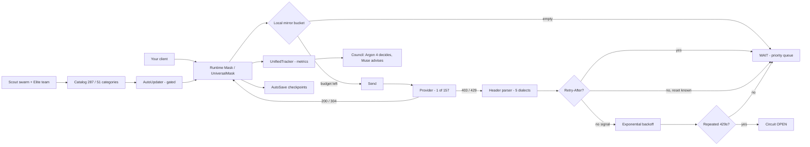
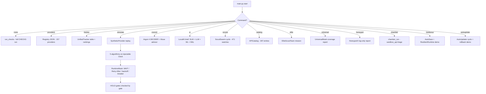
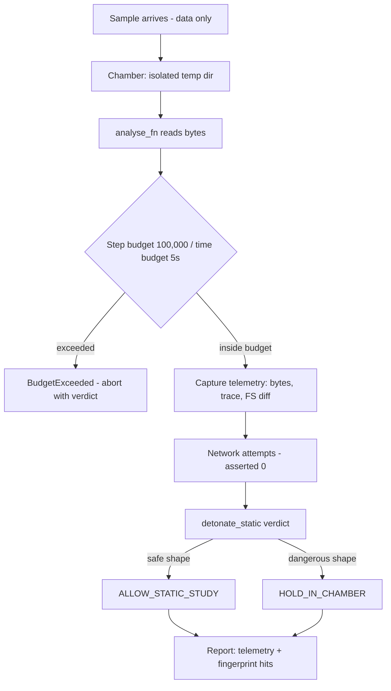
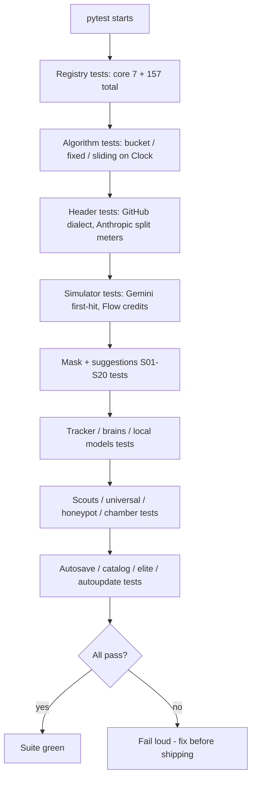

# 👉🏿 RATE-LIMIT-MASK

**An educational reverse-engineering lab for API rate limits — and one runtime mask that paces a client to live inside all of them.**

> ⚠️ **Snapshot warning:** every provider number here was checked on **2026-11-13** against published documentation and is labelled a snapshot in the code. Providers change limits without notice. The parsers trust live response headers over this registry — that is the point of the mask.

---

## ❓ What is this?

Seven limit systems look like one problem ("429") and are actually seven different machines — and 150 more systems join them in the registry. **RATE-LIMIT-MASK** takes the core seven apart with synthetic fixtures only — no live calls, no keys, no evasion — then puts a single mask in front of all of them: parse what each system reports, mirror its budget locally, queue instead of hammering, honour `Retry-After` and reset times, back off, and open a circuit breaker before a limit becomes abuse.

Inside the one project you also get:

- 📚 A registry of **157 published-limit APIs** (7 deep-modelled + 150 modelled), plus a catalog of **287 entries across 51 categories**
- 🎭 A **one-size-fits-all UniversalMask** — registry mode for the 157, generic header-learned mode for any other API
- 📊 A **UnifiedTracker** — every API checked into one table: usage, speed, latency, data size, tokens, credits, rankings
- 🧠 Two brains managing together: **Gemini Argon 4 Extended Thinking (DECIDER)** + **Muse (advisor, never overrides a HOLD)**
- 🤖 Local models built from scratch: **SLM · LLM · ML · NNL**, fused as one local **A.I** (advisory only)
- 🛰️ A **250,000-bot virtual scout swarm** + an **elite scout team** watching rules, news and updates on **471 watches**
- 🍯 **HoneypotX** (log-only) and the 🧪 **sandbox-api chamber** (merged verbatim, samples never executed)
- 💾 **Auto-save + resilient reboot** — hash-sealed checkpoints; a crash reboots normal, a tampered checkpoint is never trusted, a severe attack reboots into safe mode
- 🔄 **Auto-updates** for documented limit-value changes only — checkpoint first, changelog, one-call rollback; code never auto-updates
- 🚧 **9 HOLD gates** — the evasion actions this mask will never do, named in code

### The seven deep-modelled systems

| System | Budget scope | Counted in | Limit signal | Reset behaviour |
|---|---|---|---|---|
| GitHub REST / GraphQL / Search | per user · per IP (anon) · per repo (Actions token) | requests/h, GraphQL points/h, **secondary** points/min | 403 or 429, `x-ratelimit-remaining: 0` | `x-ratelimit-reset` epoch; secondary = honour `retry-after` |
| Gemini API | per **project** | RPM + TPM + RPD, first-hit wins | 429 `RESOURCE_EXHAUSTED` | RPM/TPM rolling 60s; RPD midnight Pacific |
| Meta Model API (Muse) | per **team**, per model | RPM + TPM | 429 + `Retry-After` | per-minute windows, reset headers |
| Google Flow | per account | **credits**: 50/day + monthly plan pool | "You've reached your usage limit" (failed gens not charged) | daily grant, no rollover |
| OpenAI API | per org **and** per project, per model | RPM / TPM / RPD / TPD / IPM | 429 `rate_limit_exceeded` | per-minute, continuous recovery |
| Claude API | per org, per model | RPM + **ITPM / OTPM split** | 429 + `retry-after` | continuous token-bucket refill |
| Claude Code | per subscription, shared with Claude apps | 5-hour session window + weekly window | session-limit message | rolling 5h from first message; rolling 7 days |

Headline snapshot numbers (checked 2026-11-13): GitHub 60/h anonymous vs 5,000/h authenticated, 900 secondary points/min (GET = 1 pt, mutation = 5 pts) · Gemini free 2.5 Flash 10 RPM / 250k TPM / 250 RPD · Muse Spark standard 3,000 RPM / 4M TPM per team, Contributor 150 RPM / 3M TPM · Flow 50 credits/day for every account, Veo Lite 10 / Fast 20 / Quality 100 credits · OpenAI flagship Build 5,000 RPM / 1M TPM → Grow 15,000 RPM / 40M TPM · Claude API Start tier 4,000 RPM / 2M ITPM / 400k OTPM · Claude Code Pro ≈10–40 prompts per 5h window (Anthropic's own estimate range — a long Opus session burns it far faster than short prompts).

### 150 more APIs in the same registry — 157 total

The seven above are deep-modelled (simulator, header dialect, tier math). 150 more limit systems sit beside them in the same `Provider` registry — each with scope, counting metrics, header dialect, limit signal, reset rule, dated headline snapshot, and a field note. The tracker, the watches, and the local models cover all 157; the simulators cover the core seven.

- **AI APIs (24 of the first 50):** Mistral AI · Cohere · xAI Grok · DeepSeek · Groq · Together AI · Fireworks AI · Perplexity · Replicate · Hugging Face · Azure OpenAI · AWS Bedrock · Vertex AI · OpenRouter · ElevenLabs · DeepL · Stability AI · Runway · AssemblyAI · AI21 · Voyage AI · Jina AI · LangSmith · Pinecone
- **Platform & dev APIs (26 of the first 50):** GitLab · Bitbucket · Docker Hub · npm · PyPI · Slack · Discord · Telegram Bot API · Twilio · SendGrid · Stripe · Reddit · X API · Spotify · YouTube Data API · Google Maps · Cloudflare · Vercel · Supabase · Notion · Airtable · Linear · Twitch Helix · Shopify · Coinbase · OpenWeather
- **The next 100 published-limit APIs:** Binance's weight system (429 → 418 ban), NASA `DEMO_KEY`, Okta's per-family tables, Auth0, Salesforce's 24h allocation, Xero's triple limits, Amazon SP-API token buckets, Docker Hub pulls, Kubernetes APF, Discord gateway budgets, Stack Exchange's in-body backoff — and 90 more systems that *publish* their limit.

The spread is the lesson: hourly windows (Bitbucket), 15-minute windows (X), 30-second rolling windows (Spotify), cost-weighted daily ledgers (YouTube: one search = 100 units), pull counts (Docker Hub), concurrency caps (Runway, AssemblyAI), character ledgers (DeepL — with its own 456 quota code), and one honest outlier (DeepSeek publishes no fixed RPM at all).

---

## 🧰 Tech Stack Badges & Full Architecture Tech Stack

### Workflow badges (updated)

[](https://github.com/kimanicollier44-cmyk/RATE-LIMIT-MASK/actions/workflows/ci.yml)
[](https://github.com/kimanicollier44-cmyk/RATE-LIMIT-MASK/actions/workflows/docker-publish.yml)
[](https://hub.docker.com/r/credkellar/rate-limit-mask)

> Honest note: these are static shields badges linked to the real Actions pages. The live `badge.svg` URLs return 404 until the repository exists on `kimanicollier44-cmyk`, the two workflows are pasted, and each has run once — then the live badges can be swapped in.

### 💻 Core Programming Languages & Core Systems


One language, one main script: **Python 3.11+, pure standard library, zero dependencies, zero network, zero keys.** `main.py` (3,536 lines) holds the registry, the 5 rate-limit algorithms, the header parsers, the runtime mask, the UniversalMask, the tracker, both brains, the 4 local models, the scout swarm, the catalog, the elite team, HoneypotX, the autosave/reboot runtime, and the auto-updater. `sandbox_api.py` is the merged chamber, verbatim.

### ⛓️ Web3 & Infrastructure


Honestly: **no blockchain, no chain calls, no wallets.** The "infrastructure" here is API infrastructure — the limit systems of 157 providers (REST, GraphQL, search, gateways, token buckets, credit ledgers) modelled as data. Two registry entries touch Web3 platforms (Binance, Coinbase) only as published-limit systems, studied the same way as every other API.

### ⚙️ Platform Support & Hardware Architecture


Runs anywhere Python 3.11+ runs — laptop, phone terminal, server, or container. No GPU, no special hardware: the local ML/NNL models are tiny from-scratch teaching models, and the 250,000 scouts are **virtual** (sharded bookkeeping, not 250,000 processes).

### ⚡ Low-Level Infrastructure & Performance


- **5 algorithms, implemented:** fixed window · sliding-window log · sliding-window counter · token bucket · leaky-bucket queue — each on an **injectable clock**, so window-edge behaviour is deterministic and testable (fixed windows allow a 2× burst across a boundary; sliding logs don't; token buckets burst to capacity but enforce the long-run rate)
- **Header translators** for the GitHub / OpenAI / Muse / Anthropic / IETF-draft dialects → one `RateState`
- **Atomic checkpoints:** temp-write + rename, hash-sealed with SHA-256 — a half-written or tampered file is never trusted

### 🛠️ DevOps & Build Tools


- `ci.yml` — Python 3.12, pytest + the self-demo CHECKS run, on push to `main` and on pull requests
- `docker-publish.yml` — Buildx build + push to `credkellar/rate-limit-mask:latest` on push to `main` (needs the owner's `DOCKERHUB_USERNAME` / `DOCKERHUB_TOKEN` secrets)
- `Dockerfile` — `python:3.12-slim`, copy the project, `CMD ["python", "main.py"]`

### ☁️ Cloud Providers


Honestly: **no cloud provider is required and no cloud call is ever made.** The lab is offline-first and synthetic. Cloud and AI providers appear only as *subjects* — their published limit systems are entries in the registry (GitHub, Gemini, Muse / Meta Model API, Google Flow, OpenAI, Claude, AWS Bedrock, Vertex AI, Azure OpenAI, Cloudflare, Vercel, Supabase, and the rest of the 157). The two brain seats detect their keys by **name presence only** (`GEMINI_API_KEY`, `MODEL_API_KEY`) — values are never read.

---

## 🔁 What this does — step-by-step

1. **Load the registry** — 157 providers, each with scope, counting metrics, header dialect, limit signal, reset rule, and a dated snapshot.
2. **Reverse-engineer the method, per provider** — (1) what is the counting unit, (2) what is the budget shared across (key? project? team? org? account? IP?), (3) which meter fires first, (4) what does the limit response actually carry, (5) how does capacity come back.
3. **Replay it synthetically** — the simulator replays those five answers with scaled-down budgets so you can watch each machine trip: GitHub mutations burning secondary points 5× faster than reads, Gemini's three meters racing, Claude's output tokens exhausting before input.
4. **Mirror the budget locally** — the runtime mask keeps a local bucket with the same shape as the provider's, keyed by provider + model + project/team scope.
5. **Pace, don't hammer** — budget left → send; empty → **WAIT** in a priority queue (interactive > normal > batch), deadline-filtered against the reset time.
6. **Read the answer's headers** — the unified translator parses whichever dialect came back into one `RateState`; live headers always beat the registry snapshot.
7. **React to a 429 like the provider asked** — `Retry-After` first, then the known reset, then exponential backoff; repeated 429s open the **circuit breaker**.
8. **Record everything in one tracker** — every call (provider, model, status, latency, bytes, tokens, credits) rolls up into the UnifiedTracker's usage / speed / data-size / token analytics and rankings.
9. **Let the brains manage** — Argon 4 decides (MAP → MODEL → STRESS → DECIDE, hashed trace), Muse advises (exactly 4 items, authority none); the Council logs the strictest verdict.
10. **Let the local A.I brief** — TinySLM summarizes a provider's rules, TinyLLM drafts the briefing, the ML classifier grades health, the NNL scores limit-risk — fused in one `brief(provider)`.
11. **Watch for changes** — the scout swarm diffs its (synthetic-fixture) wire against the snapshot on 471 watches; the elite team runs BRIEF → DISCOVER → VERIFY → CATALOG → WATCH → DECIDE → REPORT on new APIs.
12. **Survive failure** — state auto-saves to hash-sealed checkpoints; a crash reboots from the last good one, a tampered one is rejected for the previous good one, a severe honeypot pattern forces safe mode + quarantine.
13. **Update carefully** — documented limit-value changes auto-apply through the overlay with a checkpoint first and a changelog entry; anything bigger stays PROPOSED for the owner; `rollback_last()` undoes the last apply in one call.

### 20 more suggestions — all implemented

| # | Suggestion | Where |
|---|---|---|
| S01 | Unified header translator — GitHub / OpenAI / Muse / Anthropic / IETF-draft dialects → one `RateState` | `parse_headers` |
| S02 | Provider fingerprinting from headers + body | `fingerprint_provider` |
| S03 | 429 classifier: primary vs secondary vs quota vs credit vs session | `classify_429` |
| S04 | Clock-skew guard on reset timestamps | `clock_skew_guard` |
| S05 | Budget forecast: time-to-exhaustion at current pace | `forecast_exhaustion` |
| S06 | Cost-aware pacing: cheapest jobs first | `pace_rank` |
| S07 | Request dedupe + ETag conditional cache (GitHub 304s don't count when authenticated) | `DedupeCache` |
| S08 | Priority queue: interactive > normal > batch | `PriorityQueueMask` |
| S09 | Deadline-aware scheduling against reset time | `deadline_filter` |
| S10 | Webhook-over-polling advisor | `polling_advisor` |
| S11 | Batch API advisor for bulk jobs | `batch_advisor` |
| S12 | Cache-hit accounting (Anthropic/Muse cache reads ≠ OpenAI's TPM counting) | `effective_input_tokens` |
| S13 | Per-model bucket isolation | `bucket_key` |
| S14 | Shared-scope guard: per-team / per-org / per-project | `bucket_key` |
| S15 | Reset calendar for all seven systems | `reset_calendar` |
| S16 | Alert thresholds at 50 / 80 / 95% | `alert_level` |
| S17 | Incident log with classified causes | `IncidentLog` |
| S18 | Dry-run what-if burst simulator | `what_if_burst` |
| S19 | Portable JSON policy export | `export_policy` |
| S20 | Tier-upgrade math from published ladders | `tier_upgrade_math` |

### One tracker for all APIs — full metrics & analytics

Every provider checks into **one** `UnifiedTracker`. Each recorded call carries provider, model, status, latency, bytes in/out, tokens in/out, and credits, rolled up three ways — global, per-provider, per-model:

- **Usage:** calls, ok / errors / limited counts, success rate, error rate, limit rate, credits spent
- **Speed:** latency avg / p50 / p95 / p99 / max, observed requests-per-minute, tokens-per-second, bytes-per-second
- **Data size:** bytes in / out / total, human-readable size, average bytes per call
- **Tokens:** in / out / total, average tokens per call
- **Analytics rankings:** most calls · most data · most tokens · slowest p95 · most limited · highest error rate
- **One manageable table:** `python main.py tracker` prints all 157 APIs in a single table with a health column, and the same data exports as JSON (`analytics()`) or CSV (`to_csv()`)

### Secrets & variables — names only, for all 157

Every modelled provider now names the secrets and variables it needs — **by name only**: the API key, token, password, OAuth client, or account that gates its rate limit. `python main.py auth` prints the whole table (157 rows); `python main.py auth openai_api` prints one provider as JSON. Examples: GitHub → `GITHUB_TOKEN`, Gemini → `GEMINI_API_KEY`, Muse → `MODEL_API_KEY`, Docker Hub → `DOCKERHUB_USERNAME` + `DOCKERHUB_TOKEN`, Claude Code → OAuth token, Wikimedia / OpenAlex / Crossref / NOAA → no key required. **No secret value is stored anywhere** — names only, values live in your password manager / repo secrets, and the self-checks enforce it (every provider has an `auth` entry; no `=` in any name; kinds from one fixed set). Names are a dated snapshot like the limits (checked 2026-11-13) — live docs win if a provider renames one, and auth-shape changes stay PROPOSED for the owner, never auto-applied.

### The brains — Argon 4 + Muse, managing together

- 🧠 **Gemini Argon 4 Extended Thinking — DECIDER.** Carbon 4 seat, engine `gemini-2.5-pro`, model `google/gemini-carbon-4-extended-pro-thinking`. Every decision runs **MAP → MODEL → STRESS → DECIDE** with a hashed trace, at a thinking tier matched to the stakes (2048 routine / 8192 project / 32768 deploy). The tracker analytics are the MODEL stage's evidence.
- 🎭 **Muse — advisor & co-manager.** `muse-spark-1.1` / `muse-wonder-1.0`, exactly 4 advice items per decision, authority **none** — Muse can tighten, never override an Argon HOLD.
- 🤝 **Council.** Strictest verdict wins, every decision is logged with its trace hash, and `manage_project(steps)` runs a whole project plan through both seats at once.

### Local models inside — SLM · LLM · ML · NNL · A.I

- **SLM** (`TinySLM`) — a bigram-ranked extractive summarizer over the registry corpus: any provider's rules in a two-sentence brief.
- **LLM** (`TinyLLM`) — a trigram drafter over the whole corpus with seeded sampling (same seed → same text, provable in tests).
- **ML** (`MLHealthClassifier`) — softmax regression trained by gradient descent on a balanced synthetic set: tracker stats → `ok / warn / critical` with confidences.
- **NNL** (`TinyMLP`) — a 4-8-1 neural network trained with backprop on synthetic stat windows: a 0..1 limit-risk score.
- **A.I** (`LocalAI`) — the fusion layer: one `brief(provider)` returns all four together. Authority **none** — advisory only.

### One-size-fits-all — the UniversalMask

One mask, every API on Earth, no per-vendor code branch. `UniversalMask` fits a provider two ways: **registry mode** for the 157 modelled systems, and **generic learned mode** for anything else — it reads the API's own response headers (`x-ratelimit-*` family, IETF fields, `Retry-After`), registers a dynamic entry, and paces from what it learned. An API that publishes nothing still gets the safe floor: honour 429 + Retry-After, back off, circuit-break. `python main.py universal` prints the coverage report.

### Merged: HoneypotX + sandbox-api

- 🍯 **HoneypotX** — log-only analysis of synthetic TEST-NET-3 logs (12 attempts: env harvesters hunting `/.env` and API keys, scanners, rate-probes, hammering after a 429). **No listener is ever opened** (`listener_open=False`, `access_granted=False`); a severe pattern is an attack trigger for the resilience layer.
- 🧪 **sandbox-api chamber** — the fleet chamber module merged **verbatim** beside `main.py` as `sandbox_api.py`, sha256 `28b3365c0466027079a4985520840f6532d7d9a0c5b4239b840e561f06de54b0`. Its payload triage runs here: 7 payloads → **4 ALLOW_STATIC_STUDY / 3 HOLD_IN_CHAMBER**, samples are data only, **executed=False, network attempts 0**, always.

### Auto-save + reboot — crash and hack recovery

State is checkpointed **atomically** (temp write + rename) and **hash-sealed**. The `ResilientRuntime` watches its own health:

- **Crash / exception** → incident logged, runtime reboots from the last good checkpoint, normal mode.
- **Tampered checkpoint** (hash mismatch = the "being hacked" case) → the bad file is **never trusted**; the previous good checkpoint is restored instead.
- **Severe HoneypotX attack** → forced reboot into **safe mode** (everything held except pacing inside limits) with the attacking sources quarantined.

"Reboot" means an in-app restart of the mask runtime from verified state — not an OS reboot, and the scope line says so in every reboot record.

### Catalog ALL — and the elite scout team

The `APICatalog` holds **287 entries across all 51 public-API categories** — the 157 modelled providers (`published_modelled`) plus 130 seed entries (`catalogued_seed`, name + category + auth shape, awaiting scout verification of a published limit).

The **elite scout team**: 250,000 virtual bots staffed in fixed proportion (Commander 1% · Scouts 39% · Verifiers 25% · Cataloguers 15% · Watchers 15% · Analysts 5%), sharded across every provider **and** every category with a balance rule (no shard over 2× the smallest). Mission workflow: **BRIEF → DISCOVER → VERIFY → CATALOG → WATCH → DECIDE (Argon 4 + Muse) → REPORT**. Verified discoveries are **proposed, never auto-applied**; unverifiable black boxes are rejected with the reason recorded. Live fetching stays HOLD-gated: missions run on the wire they're given, `live_calls=0`.

The wider **scout swarm** runs **471 watches** — for every one of the 157 providers: **rules** (official rate-limit documentation), **news** (official changelog & announcements), **updates** (official status & update feeds). The wire here is **synthetic fixtures** (labelled `SYNTHETIC FIXTURE` — never mistakable for real news), and a detected change is **proposed, never applied**.

### Auto-updates

A scout-detected change is **auto-applied** only when it's a documented limit-value change for an already-registered provider, carrying a concrete new value, with the council at PROCEED. Before applying: an autosave checkpoint (the rollback point). After: version bump + changelog entry, value living in a live overlay over the frozen registry, and `rollback_last()` restores the old value in one call. New providers, removals, auth/secret-shape changes, and value-less reports stay **PROPOSED** for the owner; a council HOLD stops an update cold. A scheduler runs the cycle on an interval with an owner on/off switch. Scope: **registry data only — code never auto-updates.**

### HOLD gates — what the mask will never do

Rotating keys or accounts to spend another identity's budget · spoofing IP/fingerprint to escape a per-IP limit · farming accounts to multiply a free tier · ignoring `Retry-After` · hammering after a 429 · sharing one Claude Code subscription session · scripting the Flow consumer UI to drain credits · splitting one workload across orgs to multiply per-org limits · live scout fetching. Each is a named gate in `HOLD_ACTIONS`, and `gate()` returns `HOLD` with the reason.

---

## 📊 Mermaid flowchart diagram per script

### Master flow — the whole system



### `main.py` — registry, algorithms, mask, tracker, brains, models, scouts, resilience



### `sandbox_api.py` — the static chamber (verbatim merge)



### `tests/test_main.py` — the test suite



---

## 😎 Why is this cool? — 10 reasons

1. It treats "rate limit" as **157 different machines**, not one error code — and teaches the five questions that take any of them apart.
2. **One mask fits all:** the UniversalMask paces a registered provider from its published model and an unknown API from its own headers — no per-vendor code branch.
3. Claude Code and the Claude API are modelled as the **different regimes they actually are** — session windows vs token buckets.
4. Google Flow is modelled honestly as a **credit ledger**, not an API — daily grant, monthly pool, failed generations not charged.
5. The GitHub **secondary-limit point system** (mutations = 5 pts) is simulated, not just described — you can watch a write-heavy job trip it.
6. Every algorithm runs on an **injectable clock** — window-edge behaviour (like the fixed-window 2× boundary burst) is provable in tests, not folklore.
7. The header translator normalises **four real dialects plus the IETF draft** into one state object — the parser trusts live headers over its own registry.
8. **All APIs in one tracker** — usage, speed, latency percentiles, data size, tokens and credits for 157 APIs in a single table with rankings and CSV/JSON export.
9. It **survives its own failure** — hash-sealed autosave checkpoints, a tampered checkpoint never trusted, safe-mode reboot under attack, and gated auto-updates with one-call rollback.
10. It teaches staying inside limits as an engineering skill — **pacing beats hammering**, and the evasion moves are HOLD-gated by name.

## 🛠️ What problems this solves? — 10 solutions

1. **429 surprise in agent loops** → local mirror bucket with the provider's own shape + exhaustion forecast (S05), so the client slows down *before* the limit fires.
2. **Retry storms making limits worse** → `Retry-After` discipline first, exponential backoff second, circuit breaker on repeats — a 429 stops the hammering instead of feeding it.
3. **One provider's headers read with another's assumptions** → unified translator (S01) + provider fingerprinting (S02): GitHub, OpenAI, Muse, Anthropic and IETF dialects each parsed as themselves.
4. **403 ambiguity on GitHub** → the 429/403 classifier (S03) separates forbidden from primary-limit from secondary-limit, so the fix matches the cause.
5. **Bursts tripping token-bucket APIs below the average rate** → the bucket mirror bursts exactly like the real bucket does — capacity first, long-run rate enforced.
6. **Polling burning the primary budget** → webhook-over-polling advisor (S10) + ETag dedupe cache (S07): GitHub 304s don't count when authenticated, and the tracker proves the saving.
7. **Shared team/org budgets blown by one job** → scope-correct bucket keys (S13, S14) per model, project, team and org — one job can't silently spend everyone's budget.
8. **Batch work starving interactive work** → priority queue (S08) + cost-aware pacing (S06) + deadline filter (S09): interactive goes first, and jobs that can't finish before a reset don't start.
9. **Limits changing while your code doesn't** → 471 scout watches + the elite team diff published rules, news and updates against the snapshot, and the gated auto-updater applies documented value changes with a checkpoint and a rollback.
10. **Crashes and tampering losing the mask's state** → atomic, hash-sealed checkpoints: a crash reboots from the last good state, a hacked checkpoint is rejected for the previous good one, and a severe attack pattern forces safe mode with the sources quarantined.

---

## 📦 How to install this — step by step

### Option A — run it locally (nothing to install)

1. Install **Python 3.11 or newer** from [python.org](https://www.python.org/downloads/) (or your system package manager).
2. Get the code:
   ```bash
   git clone https://github.com/kimanicollier44-cmyk/RATE-LIMIT-MASK.git
   cd RATE-LIMIT-MASK
   ```
   *(Until the repo is created on that account, use the project folder you already have — the code is identical.)*
3. Run the self-demo — the full CHECKS run, synthetic only:
   ```bash
   python main.py
   ```
4. Try the commands:
   ```bash
   python main.py providers    # the registry as JSON
   python main.py tracker      # all 157 APIs in one metrics table + rankings
   python main.py council      # Argon 4 + Muse managing a project plan
   python main.py scouts       # one scout-swarm cycle over the synthetic wire
   python main.py catalog      # the full catalog: 287 entries, 51 categories
   python main.py elite        # elite scout team: staffing, balance, one mission
   python main.py universal    # one-size-fits-all coverage report
   python main.py honeypot     # HoneypotX log-only report
   python main.py chamber      # sandbox-api chamber triage (never executes)
   python main.py resilience   # autosave checkpoint + health/reboot demo
   python main.py autoupdate   # one auto-update cycle + rollback demo
   python main.py ai groq      # the local A.I brief for one provider
   python main.py simulate gemini_api 12
   ```
5. Run the tests (the only extra tool, and only for testing):
   ```bash
   pip install pytest
   python -m pytest -q
   ```

### Option B — run it in Docker

1. Install [Docker](https://docs.docker.com/get-docker/).
2. Build the image:
   ```bash
   docker build -t rate-limit-mask .
   ```
3. Run it:
   ```bash
   docker run --rm rate-limit-mask
   ```
4. Or pull the published image after the first Docker Publish run:
   ```bash
   docker pull credkellar/rate-limit-mask:latest
   docker run --rm credkellar/rate-limit-mask:latest
   ```

### Option C — publish it yourself (owner steps)

1. Create the empty repo **RATE-LIMIT-MASK** on your GitHub account and install the Muse App on it (repository select page).
2. Push the App files (everything except `.github/workflows/`).
3. Paste the two workflow files through the GitHub editor — `ci.yml` and `docker-publish.yml` — and check the tags line reads `credkellar/rate-limit-mask:latest`.
4. Add the repo secrets `DOCKERHUB_USERNAME` and `DOCKERHUB_TOKEN`.
5. Push to `main` — CI runs the tests, Docker Publish builds and pushes the image.

## ✅ Requirements

- **Python 3.11+** — that's it for running. Zero third-party dependencies, zero network access, zero API keys.
- **pytest** — only to run the test suite (`pip install pytest`).
- **Docker** — only for Option B / publishing (any recent Docker Engine or Docker Desktop).
- **Git** — only to clone or push.
- **Operating system** — Linux, macOS, or Windows; any CPU; no GPU.
- **Optional, names only:** the brain seats notice `GEMINI_API_KEY` and `MODEL_API_KEY` by **name presence** — values are never read, and the lab makes zero live calls either way. Secret *values*, passwords and tokens never belong in the code or the README — names only, values live in your password manager / repo secrets.

---

## 🌳 FULL project structure tree

```
rate-limit-mask/
├── main.py                        # 3,536 lines — EVERYTHING lives here:
│                                  #   registry (157 providers + core 7 deep models)
│                                  #   5 rate-limit algorithms on an injectable Clock
│                                  #   header translators (GitHub/OpenAI/Muse/Anthropic/IETF)
│                                  #   RuntimeMask + UniversalMask (WAIT / Retry-After /
│                                  #     backoff / circuit breaker, 9 HOLD gates)
│                                  #   suggestions S01–S20 (forecast, dedupe, priority queue…)
│                                  #   UnifiedTracker (usage / speed / data size / tokens)
│                                  #   brains: Argon 4 DECIDER + Muse advisor + Council
│                                  #   local models: TinySLM + TinyLLM + ML + TinyMLP → LocalAI
│                                  #   ScoutSwarm (250,000 virtual, 471 watches)
│                                  #   HoneypotX log-only · chamber bridge
│                                  #   AutoSave + ResilientRuntime (hash-sealed checkpoints)
│                                  #   APICatalog (287 entries, 51 categories)
│                                  #   EliteScoutTeam · AutoUpdater + scheduler
│                                  #   run_checks() self-demo + 10 CLI commands
├── sandbox_api.py                 # 123 lines — sandbox-api chamber, VERBATIM merge
│                                  #   sha256 28b3365c0466027079a4985520840f6532d7d9a0c5b4239b840e561f06de54b0
│                                  #   Chamber (step/time budgets, telemetry, network = 0)
│                                  #   + detonate_static (samples are data, never executed)
├── tests/
│   └── test_main.py               # 189 lines — pytest suite (31 tests)
├── cover.png                      # README cover banner (owner uploads the binary)
├── README.md                      # this file
├── Dockerfile                     # python:3.12-slim · COPY . . · CMD python main.py
└── .github/
    └── workflows/
        ├── ci.yml                 # push/PR: Python 3.12, pytest + self-demo CHECKS
        └── docker-publish.yml     # push to main: Buildx → credkellar/rate-limit-mask:latest
                                   #   (owner pastes this file + DOCKERHUB secrets)
```

## Scope, honestly

Educational and synthetic. No live provider is called, no credential is read, and no limit is circumvented — the runtime mask exists to respect limits more intelligently, and evasion actions are HOLD-gated by name. Provider figures are a dated snapshot (2026-11-13) for study; production clients must read live headers and current provider documentation.
